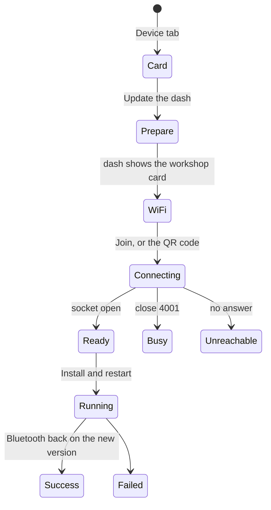

# Firmware update over Wi-Fi

The Device tab updates the dash's firmware from the phone. The phone downloads
the release while it still has internet, then hands the image to the dash over
the dash's own Wi-Fi in [workshop mode](https://github.com/CANShift/canshift-firmware/blob/main/docs/architecture/workshop-mode.md).
It speaks the same socket protocol as the tuner, so the dash checks the image
the same way whichever app sends it.

## What the user sees



| Step          | What happens                                                                                                                                                                                                                                           |
| ------------- | ------------------------------------------------------------------------------------------------------------------------------------------------------------------------------------------------------------------------------------------------------ |
| Card          | Shows the version the dash reports over BLE and the newest published release. **Download** fetches the app image and its `.sig` into the cache and checks the image against the sha256 in the release `manifest.json`                                  |
| Prepare       | Tells the driver to tap **Workshop mode** in the dash's Settings. BLE has no command for it, by design: the dash only offers it while stationary                                                                                                       |
| Wi-Fi         | On iOS the app joins the network the driver types (`NEHotspotConfiguration`, remembered in the secure store). The dash's QR code joins from the Camera app too. Without the native module, the step sends the driver to Settings                       |
| Ready         | Confirms the version and that the dash is unusable for about two minutes                                                                                                                                                                               |
| Running       | Uploading → Checking the signature → Restarting the dash → Reconnecting over Bluetooth. The screen stays awake for the whole flow; the upload can be cancelled until it finishes                                                                       |
| After restart | The dash resumes workshop mode once after an update. The app reopens the socket, sends `reboot` so the dash comes back in driving mode, forgets the dash's Wi-Fi, and lets BLE reconnect. **Updated to …** only shows when BLE reports the new version |

## Failures say what still runs

| Failure                               | The driver reads                                              |
| ------------------------------------- | ------------------------------------------------------------- |
| Signature or image refused            | Nothing was installed — the dash still runs the old version   |
| Wi-Fi dropped before the commit       | Nothing was installed, with Try again                         |
| BLE comes back on the old version     | The new version didn't start, so the dash went back           |
| BLE does not come back within 2 min   | The app can't tell yet; tap Leave on the dash, then reconnect |
| Another tuner holds the socket (4001) | Another device is connected to the dash, with Try again       |

Wire codes are logged to the Console, never shown.

## Why the pieces sit where they do

- **BLE is held, not dropped.** `BleService.holdReconnect()` stops the
  auto-reconnect loop while the dash's radio is on Wi-Fi, so no reconnect
  banner or dialog fights the flow. The flow is a takeover in `OverlayHost`,
  under a critical alert and above reconnect failed.
- **The socket client is plain TypeScript.** `dash-socket.ts`,
  `socket-transport.ts` and `ota-install.ts` import no React Native, so the
  same code runs in jest against a fake dash and in Node against the tuner's
  mock dash.
- **Origin.** React Native's iOS WebSocket sends `Origin: http://192.168.4.1`
  for `ws://192.168.4.1/ws`, one of the origins the dash allows, so the
  dash's cross-site protection needs no exception for the app.
- **Only workshop boards.** The card offers the update only on boards with
  workshop mode (`src/lib/workshop-boards.ts`); the others update over USB
  with the tuner.

## iOS configuration

| Key                                                   | Why                                         |
| ----------------------------------------------------- | ------------------------------------------- |
| `NSLocalNetworkUsageDescription`                      | iOS asks before the app reaches 192.168.4.1 |
| `NSAppTransportSecurity.NSAllowsLocalNetworking`      | plain `ws://` to the dash                   |
| `com.apple.developer.networking.HotspotConfiguration` | joining the dash's Wi-Fi from the app       |

The Wi-Fi join lives in the local Expo module `modules/dash-wifi`. The
entitlement needs the Hotspot Configuration capability on the App ID.

## Run it against the mock dash

```sh
cd ../canshift-tuner && MOCK_DASH_PORT=8790 npm run mock-dash
cd ../canshift-mobile && MOCK_DASH_URL=ws://localhost:8790/ws npm run e2e:workshop
```

The harness signs a test image with the mock's throwaway key and checks the
open, the busy refusal, a forged signature, a signed install, the version after
the reboot and leaving workshop mode.
